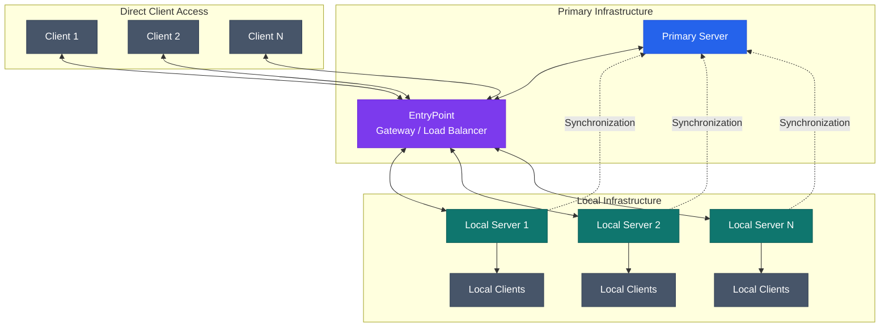

# educational
Java 21, Spring Boot, Prometheus, Grafana, Relational Database (pgress)

# roles
- Education Manager
- Director
- Director 2nd
- Teacher
- Responsible
- Student

# features
- OCR/HTR attachments
- Offline Clients and local infrastructure
- CRUD all roles
- Login (user/mail/org-mail/student-id) + password
- Send notifications and messages to all or single roles/accounts

